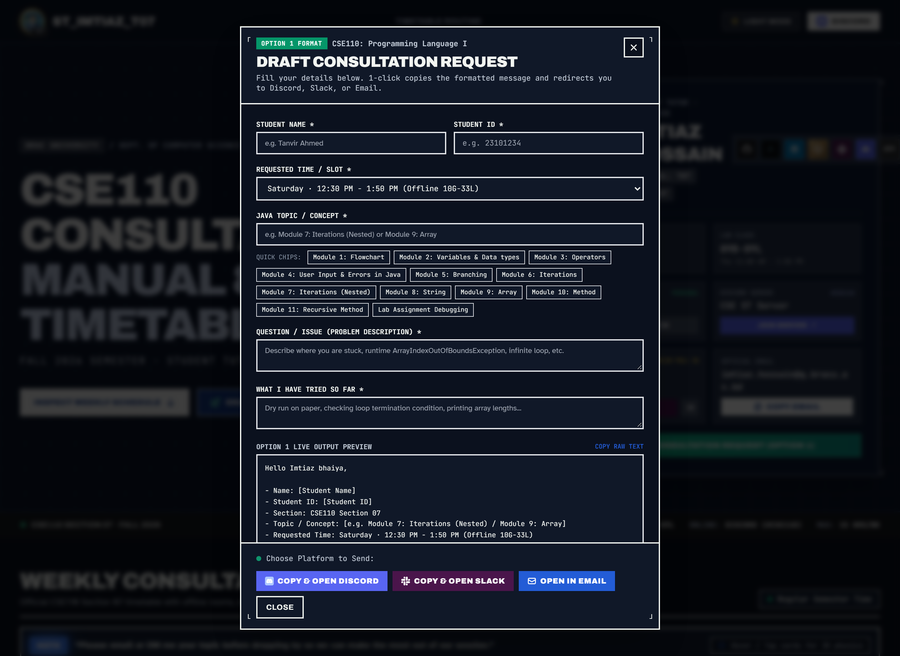
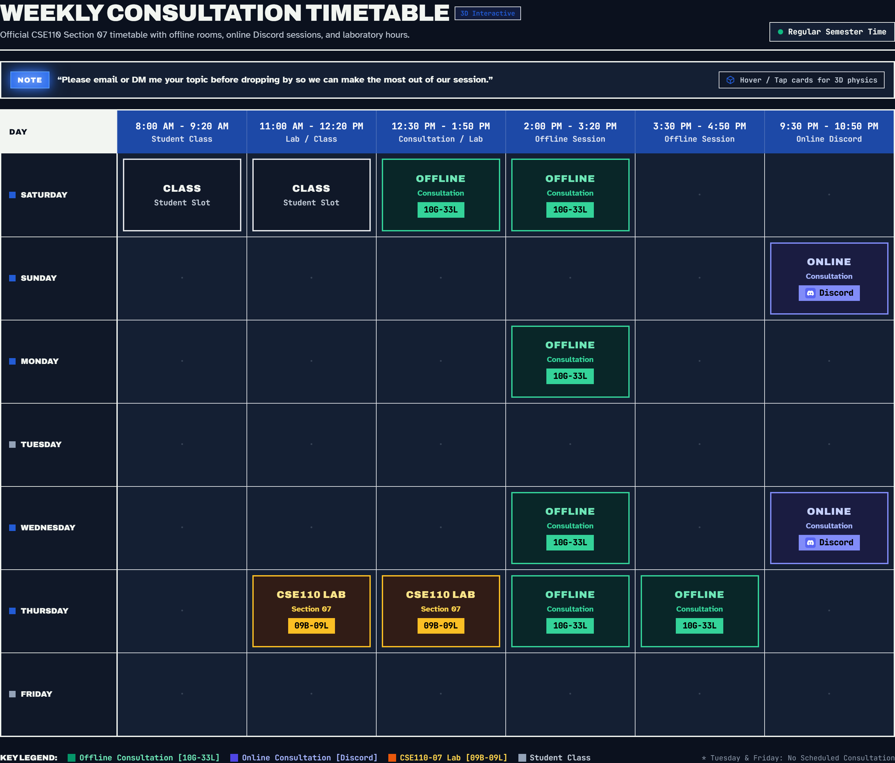

<p align="center">
  
</p>

<p align="center">
  <strong>An archival technical consultation timetable and interactive academic workspace for BRAC University CSE110 students.</strong>
</p>

<p align="center">
  ST_Imtiaz_T07 provides instant consultation lookup, 3D interactive reacting schedule cards, one-click room copying, direct Discord and Slack channels, and an interactive Option 1 consultation message composer for Fall 2026.
</p>

<p align="center">
  <a href="https://react.dev/"></a>
  <a href="https://www.typescriptlang.org/"></a>
  <a href="https://vitejs.dev/"></a>
  <a href="https://tailwindcss.com/"></a>
  <a href="https://www.framer.com/motion/"></a>
  <a href="https://www.java.com/"></a>
  <a href="https://st-imtiaz-t07.vercel.app"></a>
  <a href="https://imtiazhossain-eshan.github.io/student-tutor-imtiaz-hossain-t07-bracu/"></a>
</p>

<p align="center">
  <a href="#how-a-student-actually-uses-it">How It Works</a> ·
  <a href="#option-1-consultation-request-template">Option 1 Composer</a> ·
  <a href="#weekly-consultation-routine">Schedule Matrix</a> ·
  <a href="#slack--discord-communication-channels">Slack & Discord</a> ·
  <a href="#key-architectural-highlights">Architecture</a> ·
  <a href="#student-tutor-dossier">Tutor Dossier</a>
</p>

---

| The Routine | The Inspector | The Composer |
| :---: | :---: | :---: |
|  |  |  |

---

## How a student actually uses it

A student enrolled in BRAC University CSE110 Section 07 needs guidance debugging nested loop patterns, resolving array index out of bounds exceptions, structuring object-oriented classes and methods, or preparing for their upcoming lab exam. They open **ST_Imtiaz_T07** on their smartphone or laptop.

With a single glance, they check the day's routine to see whether Imtiaz Hossain is available for in-person consultation in room **10G-33L**, supervising the laboratory section in room **09B-09L**, or hosting evening online office hours on Discord. 

Tapping any session card reveals the interactive **Session Inspector**, allowing students to copy the room code to their clipboard with one tap, copy the tutor's personal Discord handle (`bloodrayne_`), or click **"Draft Request for this Slot"** to automatically load the slot into the Option 1 message composer.

From the composer, the student selects their Java concept, types a brief note about their attempts and runtime exceptions, and clicks one button to copy the template and jump directly to Discord, Slack, or Email.

---

## Option 1 Consultation Request Template

To keep consultation inquiries structured and ensure quick resolution, the application integrates an interactive **Option 1 Message Composer**.

### Message Format Specification

```text
Hello Imtiaz bhaiya,

- Name: [Student Name]
- Student ID: [Student ID]
- Section: CSE110 Section 07
- Topic / Concept: [e.g. Module 7: Iterations (Nested) / Module 9: Array]
- Requested Time: [Selected Slot]

Question / Issue:
[Briefly describe the specific problem or error traceback]

What I have tried so far:
[Mention your initial logic or attempts]
```

### Official CSE110 Course Modules (Interactive Quick Chips)
Students can select their current syllabus module with a single click in the composer:
* **Module 1**: Flowchart
* **Module 2**: Variables & Data types
* **Module 3**: Operators
* **Module 4**: User Input & Errors in Java
* **Module 5**: Branching
* **Module 6**: Iterations
* **Module 7**: Iterations (Nested)
* **Module 8**: String
* **Module 9**: Array
* **Module 10**: Method
* **Module 11**: Recursive Method

### One-Click Redirection Workflow

* **Discord**: Copies the Option 1 message to the student's clipboard, triggers a visual toast confirmation, and redirects directly to the [CSE ST Discord Server](https://discord.gg/S6qrvUVrgF) (`#cse110`). Students can paste the formatted block in `#cse110` or direct message personal handle `bloodrayne_`.
* **Slack**: Copies the Option 1 message to the clipboard, displays confirmation, and redirects directly to the tutor's profile on the [CSE110 Fall 2026 Slack Workspace](https://cse110fall2026.slack.com/team/U0CDM29USQ7) (Display Name: `ST_Imtiaz_T07`, Member ID: `U0CDM29USQ7`).
* **Official Academic Email**: Generates a pre-filled `mailto:` link with student credentials in the subject line and the complete Option 1 template in the email body, opening the student's preferred email client instantly.

---

## Weekly Consultation Routine

<p align="center">
  
</p>

### Active Time Matrix (80-Minute Academic Blocks)
* **Slot 1 (8:00 AM - 9:20 AM)**: Student Class
* **Slot 2 (11:00 AM - 12:20 PM)**: Lab Session / Student Class
* **Slot 3 (12:30 PM - 1:50 PM)**: Offline Consultation / Lab Session
* **Slot 4 (2:00 PM - 3:20 PM)**: Offline Consultation
* **Slot 5 (3:30 PM - 4:50 PM)**: Offline Consultation
* **Slot 6 (9:30 PM - 10:50 PM)**: Online Discord Consultation

| Day | 8:00 AM - 9:20 AM | 11:00 AM - 12:20 PM | 12:30 PM - 1:50 PM | 2:00 PM - 3:20 PM | 3:30 PM - 4:50 PM | 9:30 PM - 10:50 PM |
| :--- | :---: | :---: | :---: | :---: | :---: | :---: |
| **Saturday** | Student Class | Student Class | **Offline (10G-33L)** | **Offline (10G-33L)** | *Free* | *Free* |
| **Sunday** | *Free* | *Free* | *Free* | *Free* | *Free* | **Online (Discord)** |
| **Monday** | *Free* | *Free* | *Free* | **Offline (10G-33L)** | *Free* | *Free* |
| **Tuesday** | *Free* | *Free* | *Free* | *Free* | *Free* | *Free* |
| **Wednesday** | *Free* | *Free* | *Free* | **Offline (10G-33L)** | *Free* | **Online (Discord)** |
| **Thursday** | *Free* | **Lab (09B-09L)** | **Lab (09B-09L)** | **Offline (10G-33L)** | **Offline (10G-33L)** | *Free* |
| **Friday** | *Free* | *Free* | *Free* | *Free* | *Free* | *Free* |

*Note: Tuesday and Friday have no scheduled consultations.*

---

## Slack & Discord Communication Channels

Student consultations and technical queries are supported through dedicated platforms:

* **Slack Workspace Profile**: [CSE110 Fall 2026 Slack](https://cse110fall2026.slack.com/team/U0CDM29USQ7)
  * Display Name: `ST_Imtiaz_T07`
  * Member ID: `U0CDM29USQ7`
  * Primary official workspace for course announcements, section discussions, and direct messages.
* **Personal Discord Handle**: `bloodrayne_`
  * Use this personal handle to direct message questions, code snippets, or error tracebacks prior to dropping into a consultation slot.
* **Official CSE ST Discord Server**: [Join Discord Server](https://discord.gg/S6qrvUVrgF)
  * Course Channel: `#cse110` for real-time problem discussions, group peer debugging, screen-sharing, and voice consultations.
* **Official Academic Email**: [imtiaz.hossain@g.bracu.ac.bd](mailto:imtiaz.hossain@g.bracu.ac.bd)
  * Used for formal course inquiries, grade or attendance documentation, and scheduled consultation requests.

---

## Key Architectural Highlights

* **Archival Technical Blueprint Aesthetic**: Styled after technical shop manuals, precision engineering coordinates, and archival print paper (`#1d49a7` blueprint blue, `#0c162b` deep night, `#eceeeb` archival document paper).
* **Framer Motion 3D Tilt Physics**: Schedule cards dynamically calculate cursor delta and apply spring tilt physics with `translateZ` multi-layer parallax depth and specular sheen.
* **Option 1 Interactive Composer**: Integrated modal drawer with instant input synchronization, Java concept quick-chips, live Markdown preview, and multi-platform one-click redirection.
* **Tactile Dual-Theme Architecture**: Persistent toggle between Light Mode (technical paper) and Dark Mode (carbon blueprint night) with zero layout shift.
* **Bulletproof Asset Bundling**: Profile photos, icons, and badges are bundled and hashed via Vite for seamless deployment across GitHub Pages and custom subpaths.

---

## Tech Stack

* **Core Framework**: React 18.3 with TypeScript 5.6
* **Build System**: Vite 5.4 with static subpath asset resolution
* **Styling**: Tailwind CSS 3.4 with custom design tokens and tabular monospace numerals
* **Animation Engine**: Framer Motion 14.9 with spring physics
* **Typography**: Archivo (condensed display), Atkinson Hyperlegible (legible body), JetBrains Mono (data tables)

---

## Getting Started Locally

```bash
# Clone repository
git clone https://github.com/ImtiazHossain-Eshan/student-tutor-imtiaz-hossain-t07-bracu.git

# Enter workspace
cd student-tutor-imtiaz-hossain-t07-bracu

# Install dependencies
npm install

# Start development server
npm run dev

# Compile production bundle
npm run build

# Preview build locally
npm run preview
```

---

## Student Tutor Dossier

* **Tutor Name**: Imtiaz Hossain
* **Initial**: T07
* **Role**: Student Tutor (ST)
* **Department**: Department of Computer Science and Engineering, BRAC University
* **Course Code**: CSE110: Programming Language I (Java)
* **Section**: Section 07
* **Semester**: Fall 2026
* **Offline Consultation Room**: UB10 Building G, 10th Floor (`10G-33L`)
* **Laboratory Room**: UB09 Building B, 9th Floor (`09B-09L`)
* **Maximum Consultation Hours**: Max 15 hours per week

---

Developed by **Imtiaz Hossain** for BRAC University CSE110 Students.
