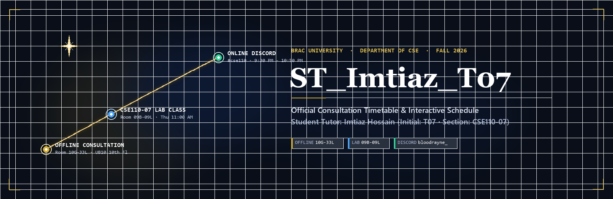
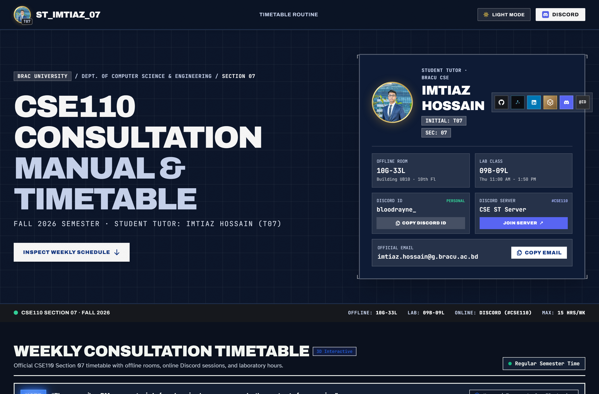
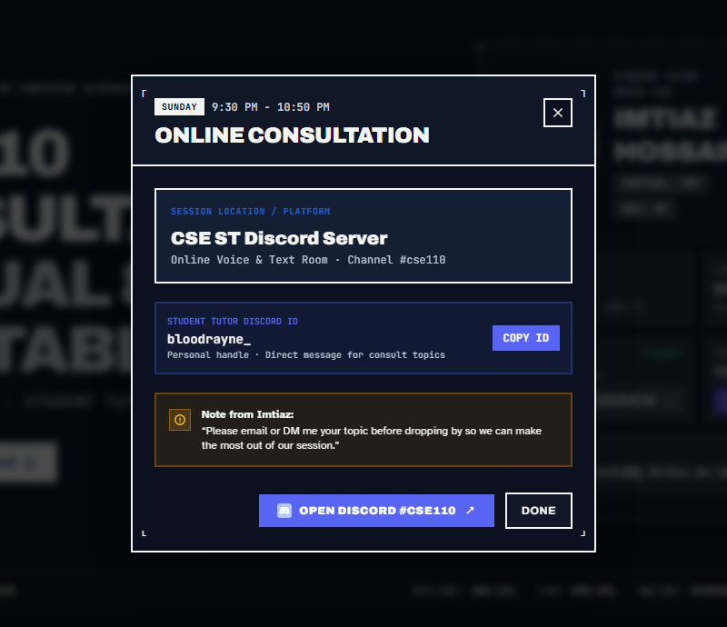
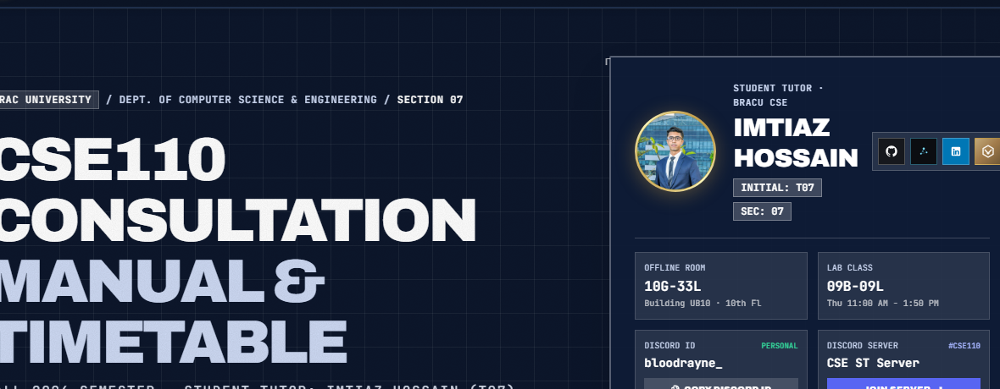

<p align="center">
  
</p>

<p align="center">
  <strong>An archival technical consultation timetable and interactive schedule for BRAC University CSE110 students.</strong>
</p>

<p align="center">
  ST_Imtiaz_T07 provides instant consultation lookup, 3D interactive reacting schedule cards, one-click room and contact copying, and direct Discord access for Fall 2026.
</p>

<p align="center">
  <a href="https://react.dev/"></a>
  <a href="https://www.typescriptlang.org/"></a>
  <a href="https://vitejs.dev/"></a>
  <a href="https://tailwindcss.com/"></a>
  <a href="https://www.framer.com/motion/"></a>
  <a href="https://st-imtiaz-t07.vercel.app"></a>
  <a href="https://imtiazhossain-eshan.github.io/student-tutor-imtiaz-hossain-t07-bracu/"></a>
</p>

<p align="center">
  <a href="#how-a-student-actually-uses-it">How It Works</a> ·
  <a href="#weekly-consultation-routine">Schedule Matrix</a> ·
  <a href="#discord--communication-channels">Discord & Contact</a> ·
  <a href="#key-architectural-highlights">Architecture</a> ·
  <a href="#quick-start">Quick Start</a> ·
  <a href="#student-tutor-profile">Tutor Dossier</a>
</p>

---

| The Schedule | The Inspector | The Dossier |
| :---: | :---: | :---: |
|  |  |  |

---

## How a student actually uses it

A student enrolled in BRAC University CSE110 Section 07 needs help debugging recursion, tracing nested loops, or preparing for their upcoming lab exam. They open **ST_Imtiaz_T07** on their smartphone or laptop.

With a single glance, they check the day's routine to see whether Imtiaz Hossain is available for in-person consultation in room **10G-33L**, supervising the laboratory section in room **09B-09L**, or hosting evening online office hours on Discord. 

Tapping any session card reveals the interactive **Session Inspector**, allowing students to copy the room code to their clipboard with one tap, copy the tutor's personal Discord handle (`bloodrayne_`) to send a preparatory direct message, or jump directly into the official `#cse110` voice and text channel on the CSE Student Tutor Discord server.

---

## Weekly Consultation Routine

### Active Time Matrix (80-Minute Academic Blocks)
* **Slot 1 (11:00 AM - 12:20 PM)**: Lab Session / Student Class
* **Slot 2 (12:30 PM - 1:50 PM)**: Offline Consultation / Lab Session
* **Slot 3 (2:00 PM - 3:20 PM)**: Offline Consultation
* **Slot 4 (3:30 PM - 4:50 PM)**: Offline Consultation
* **Slot 5 (9:30 PM - 10:50 PM)**: Online Discord Consultation

| Day | 11:00 AM - 12:20 PM | 12:30 PM - 1:50 PM | 2:00 PM - 3:20 PM | 3:30 PM - 4:50 PM | 9:30 PM - 10:50 PM |
| :--- | :---: | :---: | :---: | :---: | :---: |
| **Saturday** | Student Class | **Offline (10G-33L)** | **Offline (10G-33L)** | *Free* | *Free* |
| **Sunday** | *Free* | *Free* | *Free* | *Free* | **Online (Discord)** |
| **Monday** | *Free* | *Free* | **Offline (10G-33L)** | *Free* | *Free* |
| **Tuesday** | *Free* | *Free* | *Free* | *Free* | *Free* |
| **Wednesday** | *Free* | *Free* | **Offline (10G-33L)** | *Free* | **Online (Discord)** |
| **Thursday** | **Lab (09B-09L)** | **Lab (09B-09L)** | **Offline (10G-33L)** | **Offline (10G-33L)** | *Free* |
| **Friday** | *Free* | *Free* | *Free* | *Free* | *Free* |

---

## Discord & Communication Channels

Online consultations and student communications are structured across dedicated channels:

* **Personal Discord Handle**: `bloodrayne_`
  * Use this personal handle to send direct messages or submit questions and code snippets before dropping into a consultation slot.
* **Official Server**: [CSE ST Discord Server](https://discord.gg/S6qrvUVrgF)
  * Join the official server and navigate to channel `#cse110` for real-time group discussions, screen-share debugging, and announcements.
* **Official Academic Email**: [imtiaz.hossain@g.bracu.ac.bd](mailto:imtiaz.hossain@g.bracu.ac.bd)
  * Recommended for formal administrative inquiries, excused attendance notifications, or scheduled appointments.

---

## Key Architectural Highlights

* **Archival Technical Shop Manual Aesthetic**: Styled around technical blueprints, coordinate grid backdrops, and print document textures (`#1d49a7` blueprint blue, `#0c162b` deep night, `#eceeeb` archival paper).
* **Framer Motion 3D Reacting Cards**: Schedule cards feature 3D spring tilt physics that respond to cursor movement with parallax depth and specular sheen.
* **Session Inspector Modal**: Click or tap any consultation slot to view station details, copy room codes, copy tutor Discord handle, or join server channels.
* **Tactile Dual-Theme Architecture**: Seamless toggle between Light Mode (technical paper) and Dark Mode (carbon blueprint) with persistent localStorage state.
* **Integrated Student Tutor Dossier**: Displays academic credentials, office hours, thin metallic gold portrait ring, and one-click contact copying.

---

## Tech Stack

* **Framework**: React 18 with TypeScript
* **Build Tooling**: Vite 5
* **Styling**: Tailwind CSS with custom design tokens
* **Animations**: Framer Motion 14
* **Typography**: Archivo (condensed display), Atkinson Hyperlegible (body text), JetBrains Mono (monospace data)
* **Hosting**: Vercel (`st-imtiaz-t07`) and GitHub Pages

---

## Quick Start

```bash
# Clone the repository
git clone https://github.com/ImtiazHossain-Eshan/student-tutor-imtiaz-hossain-t07-bracu.git

# Enter project directory
cd student-tutor-imtiaz-hossain-t07-bracu

# Install dependencies
npm install

# Start local development server
npm run dev

# Build for production
npm run build

# Preview production build
npm run preview
```

---

## Student Tutor Profile

* **Student Tutor**: Imtiaz Hossain (Initial: **T07**)
* **Department**: Computer Science & Engineering, BRAC University
* **Section**: CSE110 Section 07 (Fall 2026)
* **Discord Handle**: `bloodrayne_`
* **Discord Server**: [CSE ST Discord Server](https://discord.gg/S6qrvUVrgF) (`#cse110`)
* **Offline Consultation Room**: UB10 Building G, 10th Floor (`10G-33L`)
* **Lab Class Room**: UB09 Building B, 9th Floor (`09B-09L`)
* **Official Email**: `imtiaz.hossain@g.bracu.ac.bd`
* **Portfolio**: [imtiazhossain.dev](https://www.imtiazhossain.dev/)
* **GitHub**: [@ImtiazHossain-Eshan](https://github.com/ImtiazHossain-Eshan)
* **LinkedIn**: [in/imtiazhossaineshan](https://www.linkedin.com/in/imtiazhossaineshan/)
* **Resource Vault**: [bracuvault.me](https://www.bracuvault.me/)

---

Developed by **Imtiaz Hossain** for BRAC University CSE Students.
